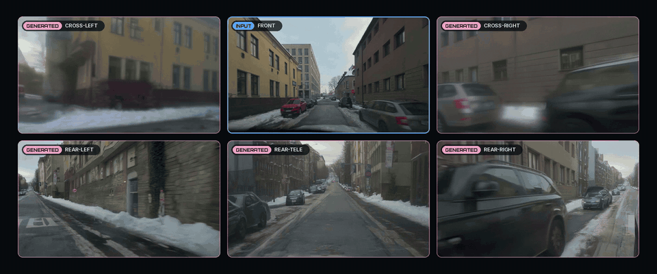

<div align="center">

<picture>
  <source media="(prefers-color-scheme: dark)" srcset="assets/logo.svg">
  
</picture>
<h2>Generative Scaling of Long-Tail Driving Data</h2>

[Lulin&nbsp;Liu](https://lulinliu.github.io/)<sup>&ast;</sup> · [Nuo&nbsp;Chen](https://nuochen1203.github.io/)<sup>&ast;</sup> · [Yan&nbsp;Wang](https://yanwang.org/) · [Bangya&nbsp;Liu](https://phddirectory.ece.wisc.edu/staff/liu-bangya/) · [Wenyan&nbsp;Cong](https://www.wenyancong.com/) · [Hezhen&nbsp;Hu](https://alexhu.top/)<br>
[Boris&nbsp;Ivanovic](https://research.nvidia.com/labs/avg/author/boris-ivanovic/) · [Hao&nbsp;Wang](https://haohww.github.io/) · [Ziyao&nbsp;Zeng](https://adonis-galaxy.github.io/homepage/) · [Xinyu&nbsp;Gong](https://gongxinyuu.github.io/) · [Yang&nbsp;Zhou](https://engineering.tamu.edu/civil/profiles/zhou-yang.html) · [Zixiang&nbsp;Xiong](https://people.engr.tamu.edu/zixiang-xiong/index.html)<br>
[Dilin&nbsp;Wang](https://wdilin.github.io/) · [Zhangyang&nbsp;Wang](https://vita-group.github.io/) · [Weisong&nbsp;Shi](https://www.cis.udel.edu/people/faculty/weisong-shi/) · [Ruohan&nbsp;Zhang](https://ai.stanford.edu/~zharu/) · [Marco&nbsp;Pavone](https://research.nvidia.com/person/marco-pavone) · [Zhiwen&nbsp;Fan](https://zhiwenfan.github.io/)<sup>†</sup>

Texas A&M University · NVIDIA · University of Wisconsin–Madison · UT Austin · Yale University · Adobe · Meta · University of Delaware · Stanford University

<sup>&ast;</sup>Equal contribution&emsp;<sup>†</sup>Corresponding author

<a href="https://arxiv.org/abs/2607.09655"></a>
<a href="https://openlongtail.github.io/"></a>
<a href="https://huggingface.co/luuuulinnnn/Openlongtail"></a>
<a href="LICENSE"></a>

</div>

> **TL;DR** — From a single <u>front-camera</u> driving video, **OpenLongTail** synthesizes the <u>five missing rig cameras</u> at the <u>same timestamps</u> — turning monocular long-tail clips into **pose-grounded, multi-view training data** for **robust VLA driving policies**.

<p align="center">
  <a href="assets/openlongtail_snow_street.mp4"></a>
  <br><em>The demo clip, a held-out long-tail scene: only the front camera (blue) is real, the five other cameras are generated.</em>
</p>

## News

- **[Oct 2026]** New checkpoint: **one model renders all five cameras** (cross views and rear views, jointly within each group), with inference, training and data-preparation code.
- **[Aug 2026]** First checkpoint and one-click demo.
- **[Jul 2026]** Paper on arXiv and initial code release.

## Release

- [x] Checkpoint (one model, all five cameras)
- [x] Inference code and one-click demo
- [x] Training code and the training-sidecar builders

## Table of Contents

- [How it works](#how-it-works)
- [Installation](#installation)
- [Demo](#demo)
- [Inference](#inference)
- [Training Data](#training-data)
- [Training](#training)
- [Code Structure](#code-structure)
- [Citation](#citation)

## How it works

OpenLongTail builds on [Wan2.1-VACE-1.3B](https://github.com/Wan-Video/Wan2.1). One network generates the five surround cameras in two stages:

| stage | generates | conditioned on |
|---|---|---|
| **1** | Cross-Left, Cross-Right, **jointly** | the front video, forward-warped into each cross camera with its depth |
| **2** | Rear-Left, Rear-Tele, Rear-Right, **jointly** | a **ground prior** built from the front and the stage-1 views: road seen at earlier frames of the clip, reprojected through the ground plane with the ego poses (and mirrored beyond the distance driven) |

In both stages the target videos and the clean front video are laid end to end along the frame axis and the pretrained Wan self-attention runs over the whole sequence, so the targets are generated consistently with the front and with each other. Views are told apart by Plücker-ray, camera-id and ego-motion embeddings, each view has its own timestep (the front stays clean), and the geometric prior of each target enters through its VACE context.

## Installation

```bash
git clone https://github.com/phai-lab/OpenLongTail.git
cd OpenLongTail

conda create -n openlongtail python=3.11 -y
conda activate openlongtail
pip install torch==2.8.0 torchvision==0.23.0 --index-url https://download.pytorch.org/whl/cu128
pip install -r requirements.txt
pip install -e .
```

Download the checkpoint, the Wan2.1-VACE-1.3B base model (~18 GB), the Wan code and the demo clip:

```bash
bash scripts/download.sh
```

## Demo

Generate the five surround cameras of the demo clip, a long-tail scene from the held-out set (a narrow city street after snowfall, lined with parked cars), and build a PRED-vs-GT gallery:

```bash
bash scripts/demo.sh                   # one GPU, ~10-15 min on an H200
```

The gallery is written to `demo/outputs/gallery/index.html`.

Or run on your own front-camera video. Depth comes from Depth Anything V2 and ego poses from [MapAnything](https://github.com/facebookresearch/map-anything) (install it, or pass `--synthetic-pose` to assume constant forward motion); the other five cameras are generated on the reference rig in [`assets/reference_rig.pt`](assets/reference_rig.pt). Depth Anything V2, Qwen2.5-VL-7B (scene caption) and Mask2Former (ground prior) are downloaded from Hugging Face on first use:

```bash
bash scripts/demo.sh --raw path/to/front.mp4
```

## Inference

```bash
# raw clips: a front video with depth and ego poses per clip (tools/prepare_dashcam.py builds them from plain mp4s)
bash scripts/infer.sh --input path/to/clips --output outputs/infer

# preprocessed clips (latent cache, see Training Data)
bash scripts/infer.sh --input path/to/cache --output outputs/infer --cached
```

Every clip directory gets `pred_{cross_left,cross_right,rear_left,rear_right,rear_tele}.mp4`, `front_input.mp4` and a `surround.mp4` preview. On raw clips a one-sentence scene caption from Qwen2.5-VL conditions both stages (`--no-caption` to skip).

`scripts/infer.sh` captions the raw clips and calls `python -m openlongtail.scripts.infer`, which runs both stages in one process. It takes `--cached` for latent-cache input, `--num-shards / --shard-index` to split clips over GPUs, `--num-steps`, `--seed`, the guidance scales `--cross-guide` / `--rear-guide` and `--ckpt` for another checkpoint.

## Training Data

Training reads a **latent cache** of six-camera clips plus per-clip sidecars. The cache itself is built from your own multi-camera dataset (this repository does not include a builder for it): 41 consecutive frames per clip at 480×832, encoded with the Wan VAE, the cameras in the order of `SENSOR_ORDER` in [`config.py`](openlongtail/config.py), and the front camera's ego poses at the 11 latent frames (frame 0 = identity, OpenCV axes). The sidecars are built from it as described below.

```
<cache>/per_uuid/<uuid>/clip_<id>.pt           {'z_all': (6,16,11,60,104), 'K': (6,3,3) at 480x832, 'E': (6,4,4) camera->rig, 'uuid',
                                                'cache_version': 'latent_t41_stride1_v1', 'output_size': (480, 832),
                                                'frame_indices': {sensor: (41,) frame of the source video}}
<cache>/per_uuid/<uuid>/clip_<id>_p4.pt        {'T_anchor_front': (11,4,4)}  front-camera ego poses
<cache>/per_uuid/<uuid>/clip_<id>_warp.pt      stage 1: the front warped into the two cross cameras
<cache>/per_uuid/<uuid>/clip_<id>_gprior.pt    stage 2: ground prior of the three rear cameras
<cache>/per_uuid/<uuid>/clip_<id>_rearlane.pt  stage 2: lane-marking mask of the ground-truth rear views
<cache>/text_cache/null.pt, text_cache/per_uuid/<uuid>.pt   UMT5 caption embeddings
```

Build the sidecars (the warps need the source front videos and their metric depth under `DATA_ROOT`, see [`build_warp_sidecars.py`](openlongtail/scripts/build_warp_sidecars.py); the stage-2 sidecars need only the cache) and the caption embeddings (one caption per scene, as `per_uuid/<uuid>.txt` — the layout `python -m openlongtail.scripts.build_captions` writes for raw clips — or as `<uuid>/vlm_caption.txt`):

```bash
LATENT_CACHE_ROOT=data/openlongtail_cache DATA_ROOT=data/by_uuid bash scripts/prepare_data.sh
LATENT_CACHE_ROOT=data/openlongtail_cache NUM_SHARDS=8 SHARD_INDEX=0 bash scripts/prepare_data.sh   # shard i of 8, in parallel
python -m openlongtail.scripts.encode_captions --captions data/captions --output-root data/openlongtail_cache/text_cache
```

## Training

One run trains both stages: every step is a stage-1 step (the two cross views from the depth warp) or a stage-2 step (the three rear views from the ground prior, with lane-marking pixels up-weighted), half of the steps each. Trained are the LoRA of every self-attention, the base weights of the self-attention and the camera / pose embeddings, with fp32 master weights.

```bash
LATENT_CACHE_ROOT=data/openlongtail_cache bash scripts/train.sh                     # one node, 8 GPUs -> outputs/train
NNODES=2 NODE_RANK=0 MASTER_ADDR=node0 LATENT_CACHE_ROOT=... bash scripts/train.sh   # multi-node
```

Training starts from the released checkpoint (`--init-from none` starts from Wan2.1-VACE with fresh LoRA and embeddings instead) and resumes from the newest checkpoint in the output directory. The released checkpoint was trained for 40k steps on 2 nodes × 8 GPUs with these defaults, starting from earlier cross-view and rear-view training of the same model. Run inference with a trained checkpoint through `python -m openlongtail.scripts.infer ... --ckpt outputs/train/step_00040000`.

## Code Structure

```
openlongtail/
  config.py            paths, camera rig, model configuration
  geometry.py          rig poses, Plücker rays, pose features, depth splatting
  flow.py              flow-matching noise schedule
  models/              surround.py (the model, both stages) · wan.py (Wan2.1-VACE, LoRA, VAE, UMT5)
  data/                latent-cache dataset · depth warp · ground prior · raw clips
  inference/           stage-1 / stage-2 samplers, video io
  training/            train.py · common.py (distributed, optimizer)
  scripts/             inference, sidecar and caption builders
scripts/               demo, inference, data preparation and training launchers
tools/                 raw-video preparation, MapAnything poses, demo gallery
```

## Citation

```bibtex
@misc{liu2026openlongtailgenerativescalinglongtail,
      title={OpenLongTail: Generative Scaling of Long-Tail Driving Data},
      author={Lulin Liu and Nuo Chen and Yan Wang and Bangya Liu and Wenyan Cong and Hezhen Hu and Boris Ivanovic and Hao Wang and Ziyao Zeng and Xinyu Gong and Yang Zhou and Zixiang Xiong and Dilin Wang and Zhangyang Wang and Weisong Shi and Ruohan Zhang and Marco Pavone and Zhiwen Fan},
      year={2026},
      eprint={2607.09655},
      archivePrefix={arXiv},
      primaryClass={cs.CV},
      url={https://arxiv.org/abs/2607.09655},
}
```

## Acknowledgements

OpenLongTail builds on [Wan2.1-VACE](https://github.com/Wan-Video/Wan2.1) (video diffusion backbone) and the [Wan2.2](https://github.com/Wan-Video/Wan2.2) VAE and text-encoder code, [Depth Anything V2](https://github.com/DepthAnything/Depth-Anything-V2) and [DepthCrafter](https://github.com/Tencent/DepthCrafter) (depth), [MapAnything](https://github.com/facebookresearch/map-anything) (camera poses), [Mask2Former](https://github.com/facebookresearch/Mask2Former) (road segmentation for the ground prior), [Qwen2.5-VL](https://github.com/QwenLM/Qwen2.5-VL) (scene captions) and [PyTorch3D](https://github.com/facebookresearch/pytorch3d) (rotation utilities). We thank the authors for releasing their code and models.

## License

Released under the [MIT License](LICENSE); the released weights are Apache-2.0, and base models remain under their respective licenses. Code adapted from Wan2.1 and PyTorch3D keeps its original license, see [THIRD_PARTY_NOTICES](THIRD_PARTY_NOTICES).
